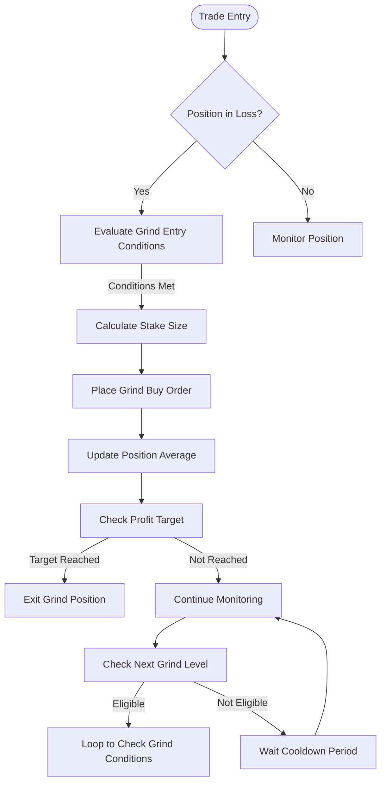
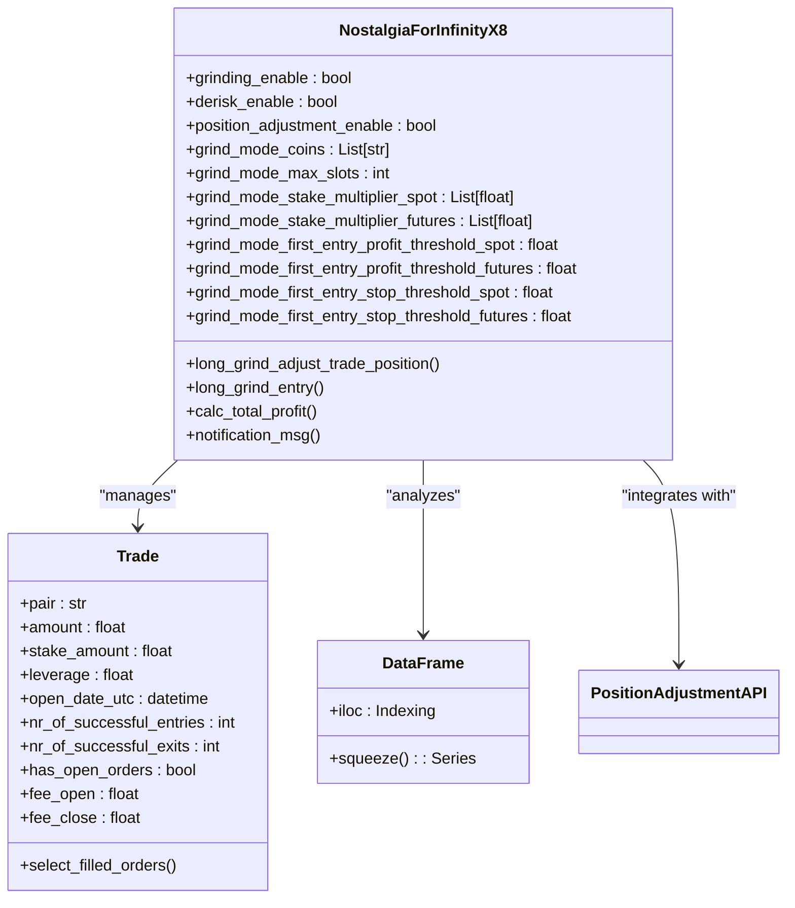
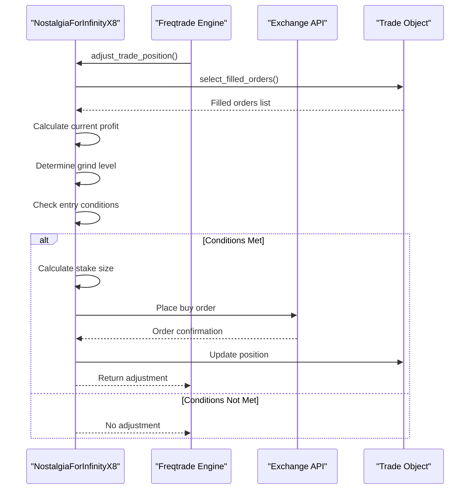
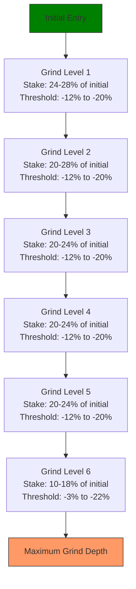
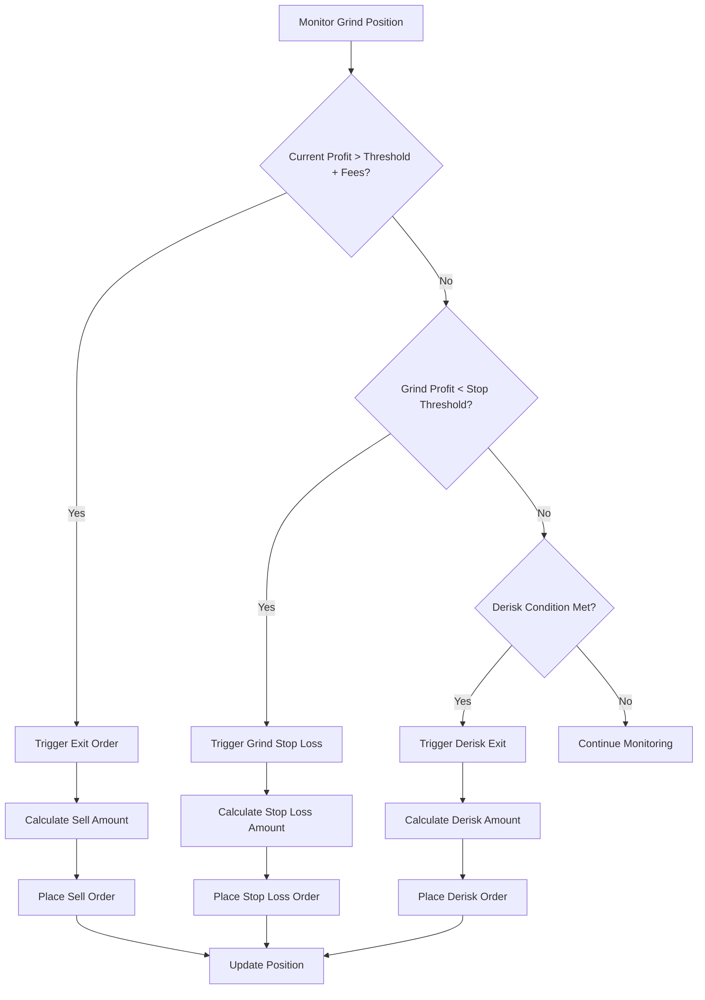
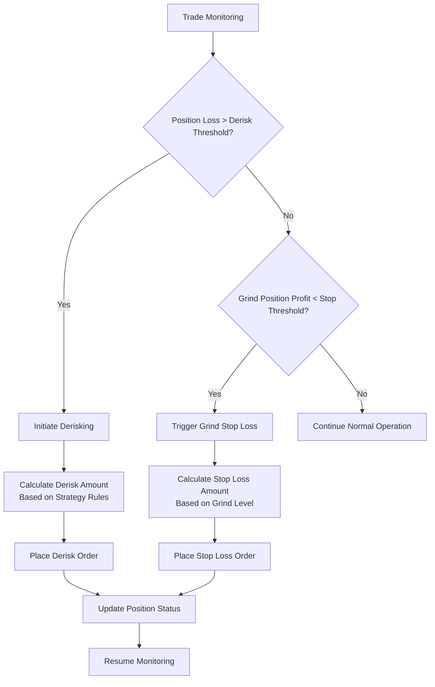

# Grinding Mechanism

<cite>
**Referenced Files in This Document**   
- [NostalgiaForInfinityX8.py](file://NostalgiaForInfinityX8.py#L1-L65286)
- [test_NFIX6.py](file://tests/unit/test_NFIX6.py#L59-L125)
</cite>

## Table of Contents
1. [Introduction](#introduction)
2. [Grinding Mechanism Overview](#grinding-mechanism-overview)
3. [Core Components and Configuration](#core-components-and-configuration)
4. [Position Adjustment Workflow](#position-adjustment-workflow)
5. [Grinding Levels and Dynamic Sizing](#grinding-levels-and-dynamic-sizing)
6. [Profit Thresholds and Exit Conditions](#profit-thresholds-and-exit-conditions)
7. [Risk Management and Derisking](#risk-management-and-derisking)
8. [Configuration Parameters](#configuration-parameters)
9. [Performance and Exchange Considerations](#performance-and-exchange-considerations)
10. [Best Practices and Tuning](#best-practices-and-tuning)

## Introduction
The Grinding Mechanism in the NostalgiaForInfinityX8 strategy is a sophisticated position averaging system designed to reduce the average entry price of losing trades through controlled, incremental buying. This approach aims to improve profitability by systematically lowering the break-even point while maintaining strict risk controls. The mechanism leverages Freqtrade's position adjustment API to dynamically manage open trades, allowing for multiple entries and exits based on predefined thresholds and market conditions.

This document provides a comprehensive analysis of the grinding system, focusing on its implementation, configuration options, and operational logic. It explains how the strategy handles different market scenarios, manages risk exposure, and interacts with exchange APIs to execute trades safely and efficiently.

## Grinding Mechanism Overview
The grinding mechanism in NostalgiaForInfinityX8 enables the strategy to average down on losing positions using progressively smaller position sizes. This approach reduces the average entry price while managing risk through predefined thresholds and position sizing rules. The system is activated when a trade enters a loss zone and meets specific entry conditions based on technical indicators and price action.

The mechanism operates through a series of "grind levels," each with its own stake size, entry threshold, and profit target. When a trade reaches a predefined loss threshold, the system places a new buy order with a stake size determined by the current grind level. The stake sizes decrease progressively across levels, preventing excessive capital allocation to a single losing position.

The grinding process is tightly integrated with Freqtrade's position adjustment API, which allows for dynamic modification of open trades without closing them. This enables the strategy to add to positions incrementally while maintaining accurate profit calculations and risk management. The system also implements cooldown periods between entries to prevent over-trading during volatile market conditions.



**Diagram sources**
- [NostalgiaForInfinityX8.py](file://NostalgiaForInfinityX8.py#L34686-L39203)

**Section sources**
- [NostalgiaForInfinityX8.py](file://NostalgiaForInfinityX8.py#L34686-L39203)

## Core Components and Configuration
The grinding mechanism is implemented through several key components and configuration parameters that work together to manage position adjustments. The core functionality is contained in the `long_grind_adjust_trade_position` method, which handles all aspects of the grinding process for long positions.

The system uses a tagging mechanism to identify trades that should be subject to grinding. Trades with specific entry tags (such as "120" for long grind mode) are eligible for position adjustments. The strategy maintains separate configuration parameters for spot and futures trading modes, allowing for different risk profiles and position sizing rules.

Key configuration elements include:
- **grind_wallets**: Not explicitly defined as a parameter, but position sizing is controlled through stake multipliers and thresholds
- **grind_levels**: Implemented through multiple grind level configurations (grind_1 through grind_6)
- **Dynamic position sizing**: Calculated based on account balance, risk parameters, and current market conditions

The system also supports different grinding modes, including regular grinding, derisk grinding, and specialized modes for rebuy and rapid trading scenarios. Each mode has its own set of parameters controlling stake sizes, entry thresholds, and profit targets.

### Default V4 long queues 4 and 9

The default V4 long callback splits the original queue-4 ladder into two independently managed queues in both spot and futures. Queue 4 admits at most two active entries. Queue 9 uses the original third and fourth stakes after the existing queue-4 minimum-stake scaling. The default stake ratios are therefore `0.05, 0.06` for queue 4 and `0.07, 0.08` for queue 9, subject to the existing leverage conversion and minimum uplift. A shorter custom ladder supplies only its actual remaining steps; it does not create replacement allocations.

A new `grind_9_entry` requires exactly two currently open, filled queue-4 entries and a positive quantity-weighted queue-4 entry price. The current entry quote must be at or below that average multiplied by `1 - system_v4_grind_9_primary_gap`. The default gap is `0.10`, a 10% raw price move independent of leveraged profit. This is a level check on each callback, with no remembered crossing. Lifetime fills, unfilled orders and old queue-4 clusters do not qualify; existing clusters with three to five queue-4 entries retain their accounting and exits but admit neither another queue-4 entry nor a new queue-9 entry.

Queue 9 has at most two entries, limited further by the original ladder's remaining length. It keeps its own average, spacing, profit high-water marks, exit tags and de-risk accounting, while inheriting queue 4's profit and de-risk settings. Its first entry retains the native empty-queue spacing bypass and uses the weighted-parent price gate, without an additional spacing test against the newest queue-4 fill. Its second entry uses the original fourth-step threshold at index `3`, measured from its own first queue-9 fill. Its profit exit and de-risk remain available after queue 4 closes. Filled order tags reconstruct both queues after a database reload, and canceled partial reductions use the existing retry-first protocol.

Queue 9 is evaluated after all existing queue-1 through queue-5 and buyback decisions. Its inventory contributes to the shared exposure and open-grind aggregates, including the existing queue-5 rescue count guard. Existing signal, timing, retry, wallet, stake, fee and minimum-residual checks still apply. The shared queue-4 configuration lists, short callbacks and earlier system versions retain their existing ladders.

A funded buyback keeps its existing priority. An unaffordable buyback still blocks a new queue-9 entry, but it does not suppress the profit exit or de-risk of queue-9 inventory already open.

The queue-9 configuration parameter is long-V4-only and is accepted without advanced mode:

```json
{
  "nfi_parameters": {
    "system_v4_grind_9_primary_gap": 0.10
  }
}
```

Change note: long V4 now enables this two-plus-two split by default; no separate opt-in or queue-9 stake configuration is required.

### Default V4 long queues 1 and 6

Long V4 also splits the original queue-1 ladder in both spot and futures. Queue 1 admits at most two current filled entries, or fewer when its configured ladder is shorter. Queue 6 takes only the original third and fourth stakes and thresholds, using `[2:4]` after the existing queue-1 minimum-stake scaling. The shipped stake ratios remain `0.20, 0.20` for each half; the shared configuration lists are not shortened. Old queue-1 clusters containing three to five entries still receive their full native accounting, profit exits and de-risk, but do not unlock a new queue-6 entry.

Queue-6 admission requires exactly two currently open filled queue-1 entries and a positive quantity-weighted parent average. The current **entry quote** must be at or below that average times `1 - system_v4_grind_6_primary_gap`. The default `0.10` gap is inclusive and uses raw price, not leveraged profit or the most recent parent's price. No cycle or crossing state is stored. The first lower entry keeps the native empty-queue spacing bypass; its second uses the original index-3 threshold, `-0.21` by default, against its own latest fill.

Queue 6 has separate quantity, cost, average, count, high-water data and `grind_6_entry`, `grind_6_exit` and `grind_6_derisk` tags. It inherits queue 1's normal entry signal, pre-de-risk controls, profit threshold and de-risk settings; it does not use queue 4's fallback signal. Existing queue-6 profit exits and de-risk remain reachable after the parent closes or is disabled, including after a database reload. The native parent de-risk retains priority: with default settings, it can close queue 1 before a descending market reaches queue 6's second-entry spacing. The split does not weaken that reduction to guarantee four consecutive buys.

All original queue-1 through queue-5 and buyback decisions, followed by the complete accepted queue-9 handling, precede queue 6. A funded buyback still wins; an unfunded buyback blocks new queue-6 admission without hiding existing queue-6 reductions. Queue 6 participates in shared exposure, profit and open-entry accounting and the native global-de-risk order boundary. Its canceled partial reductions retain the existing retry-first, current-value minimum, 1.55-times residual reserve and spot base-fee rules. Only long-V4 queue-6 exit/de-risk fills reset its own high-water marks.

The gap is accepted in either top-level configuration or `nfi_parameters` without advanced mode:

```json
{
  "nfi_parameters": {
    "system_v4_grind_6_primary_gap": 0.10
  }
}
```

Change note: this long-V4-only split is active by default, without a separate queue-6 ladder, reserve or signal. The legacy grind-mode `gd6` namespace, short ladders and earlier system versions are unchanged.

### Default V4 long queues 2 and 7

The same two-plus-two split also applies to queue 2 in long V4 spot and futures: parent queue 2 admits at most two current filled entries, and lower queue 7 receives only the original already-minimum-scaled stakes `[2:4]` and corresponding thresholds. The default stake ratios are `0.10, 0.12` for queue 2 and `0.14, 0.16` for queue 7. Shorter custom ladders supply only the actual remaining entries; old three-to-five-entry parent clusters remain fully managed but do not unlock queue 7.

Queue 7 requires exactly two currently open filled queue-2 entries with a positive quantity-weighted average. Its inclusive entry-quote gate uses `parent_average * (1 - system_v4_grind_7_primary_gap)`, with a safe, long-V4-only default gap of `0.10`. The first lower entry uses the native empty-queue spacing bypass; the second uses original index `3`, `-0.09` by default, measured from its own first fill. It inherits queue 2's profit threshold (`0.035` by default), de-risk threshold/use flag and normal signal/pre-de-risk controls, without a queue-4 fallback.

Queue 7 independently reconstructs its amount, cost, average, count, spacing, high-water data and `grind_7_entry` / `grind_7_exit` / `grind_7_derisk` tags after reload. Parent closure or admission disablement does not remove management of existing lower inventory. The established partial-reduction retry, minimum/reserve and spot base-fee rules apply, and its inventory participates in shared profit, exposure and rescue-count accounting. Its filled exit/de-risk resets are restricted to its own stored long-V4 cluster.

Decision priority is original queues 1–5 and buyback, then the **complete** queue-9 handling, then queue 6, then queue 7, followed by queues 8 and 10. A funded buyback still wins; an unfunded buyback blocks new lower admission without suppressing existing lower reductions. Accepted queue 4/9, all short ladders, earlier systems and legacy `gd6` retain their existing behavior.

The gap can be configured at the top level or without advanced mode under `nfi_parameters`:

```json
{
  "nfi_parameters": {
    "system_v4_grind_7_primary_gap": 0.10
  }
}
```

Change note: queue 2/7 is enabled by its existing parent controls, with no additional ladder, signal or reserve.

### Default V4 long queues 3/8 and 5/10: all five splits

Long V4 spot and futures now split every original parent: **1/6, 2/7, 3/8, 4/9 and 5/10**. Each parent cap is `min(2, len(original_scaled_stakes))`; each lower receives only the actual original stakes and thresholds `[2:4]`, after the parent's native minimum scaling. Empty ladders admit nothing, short ladders create no replacement capital, and historical overfull parents remain fully managed without admitting new parent or lower entries. Configuration lists remain intact for short and earlier-system callbacks.

Queue 3's default ratios are `0.10, 0.12` for the parent and `0.14, 0.16` for queue 8. Queue 5's are `0.05, 0.06` for the parent and `0.07, 0.08` for queue 10. Both new lowers require **exactly two current filled parents**, a positive quantity-weighted parent average, and an inclusive **current entry quote** comparison against `parent_average * (1 - primary_gap)`. The default gap is a raw 10%, independent of leverage, not a PnL threshold or a remembered crossing. The first lower entry keeps the empty-queue spacing bypass; the second uses original index `3` (`-0.09` by default) against its own latest fill.

Queues 8 and 10 have separate reconstructed amount, cost, count, average, spacing, high-water marks, entry/exit/de-risk tags and canceled-partial retry routing. They inherit their own parent's profit and de-risk settings, including pre-de-risk admission, and remain manageable after the parent closes or admission is disabled and after database reload. Only their own stored long-V4 exit/de-risk fills reset their two high-water marks. Current-value minimums, leverage conversion, fee-net spot settlement, retry-first handling and the native 1.55-times minimum residual reserve still apply. Parent de-risk retains priority and can preempt a second lower fill; four consecutive buys are not guaranteed by the defaults.

Queue 5 keeps its native admission order: prior-de-risk fallback (`g5_fb1`, loss strictly beyond 6% plus its original indicators), original liquidation route (`g5_liq1`, loss strictly beyond 15% plus the native liquidation expression), ordinary signal, small-margin rescue (`g5_liq2`), then pre-de-risk. These loss guards use the raw change from the **latest filled entry** to `exit_rate` (`slice_profit_entry`), not the initial main entry or the weighted parent average. Rescue only admits the **next original parent step**; it adds no separate allocation. Its amount is always the scaled native ladder step divided by leverage, floored at `1.5 * minimum` and admitted only when no greater than `max_stake`.

The small-margin rescue retains its futures-only, positive/noncrossed liquidation, strict `< 1.20 * liquidation` and configurable strict loss threshold (default 5%) guards. It also requires **at most one open entry across all grinds, buybacks and rebuy**, including 8/10, and total trade cost-basis stake plus the minimum-uplifted next original step no greater than `0.50 * original_slice / leverage`. Two current parent-5 entries already make that shared count at least two: **rescue alone does not unlock queue 10**. No parents are excluded from that count and no rescue budget, gap or emergency guard is widened.

Queue 10 inherits the applicable queue-5 fallback, original liquidation, ordinary and pre-de-risk routes, with `g10_fb1`, `g10_liq1`, `g10` and `g10_pre_derisk` diagnostics. It does not borrow queue 4/9's different fallback, or index a hypothetical parent-5 rescue step. The small-margin rescue route is omitted for queue 10 because its required two parents make that route inapplicable. The original `g5_liq1` expression is preserved as written; the stronger positive/noncrossed checks belong to `g5_liq2`, not an unrelated correction to `g5_liq1`.

Retry and emergency/ordinary de-risk levels 1–4 remain first, then original queues 1–5 and buyback/rebuy, then complete queue handling in **9, 6, 7, 8, 10** order. This includes each earlier queue's reductions before a later queue's entries. New 8/10 inventory participates in all shared open-count/profit/exposure accounting. A funded buyback wins; an unaffordable buyback blocks new lower entries without hiding existing lower reductions. Parent 4's reentry remains unchanged.

Both new gap parameters are accepted at the top level or under `nfi_parameters`, without advanced mode:

```json
{
  "nfi_parameters": {
    "system_v4_grind_8_primary_gap": 0.10,
    "system_v4_grind_10_primary_gap": 0.10
  }
}
```

Change note: 3/8 and 5/10 complete the default long-V4 two-plus-two source implementation. The parent caps, delayed lower admission and larger shared open-count membership intentionally change rescue admission and portfolio trajectories; they are not rescue parity, market parity or a market-benefit claim. No separate reserve, new signal, retagging, parent promotion, cycle state or gap tuning is introduced. The older queue-5 description below belongs to the earlier grinding system, not this V4 contract.




**Diagram sources**
- [NostalgiaForInfinityX8.py](file://NostalgiaForInfinityX8.py#L2265-L2265)
- [NostalgiaForInfinityX8.py](file://NostalgiaForInfinityX8.py#L34686-L39203)

**Section sources**
- [NostalgiaForInfinityX8.py](file://NostalgiaForInfinityX8.py#L34686-L39203)

## Position Adjustment Workflow
The position adjustment workflow in the grinding mechanism follows a systematic process to evaluate and execute additional entries on losing positions. The workflow begins when the `adjust_trade_position` method is called by Freqtrade's position adjustment system, which triggers the appropriate adjustment function based on the trade's entry tags.

The workflow starts with validation checks to ensure the trade is eligible for adjustment. The system verifies that the trade has completed its initial entry and does not have any open orders that could conflict with new entries. It then calculates the current profit/loss ratio and determines the appropriate grind level based on the current market conditions and the trade's performance.

Key steps in the workflow include:
1. **Data Collection**: Retrieve the latest market data and trade information
2. **Eligibility Check**: Verify the trade meets all conditions for grinding
3. **Stake Calculation**: Determine the appropriate stake size based on the current grind level
4. **Entry Condition Evaluation**: Assess technical indicators and price action for entry signals
5. **Order Execution**: Place the grind buy order with appropriate tagging
6. **Position Update**: Update the trade's average entry price and profit calculations

The system implements several safety checks to prevent over-leveraging and ensure compliance with exchange requirements. These include minimum stake amount validation, maximum position size limits, and cooldown periods between entries. The workflow also handles partial fills and adjusts subsequent orders accordingly.



**Diagram sources**
- [NostalgiaForInfinityX8.py](file://NostalgiaForInfinityX8.py#L34686-L39203)
- [test_NFIX6.py](file://tests/unit/test_NFIX6.py#L59-L86)

**Section sources**
- [NostalgiaForInfinityX8.py](file://NostalgiaForInfinityX8.py#L34686-L39203)

## Grinding Levels and Dynamic Sizing
The grinding mechanism implements multiple levels of position adjustments, each with progressively smaller stake sizes. This approach allows the strategy to average down on losing positions while reducing risk exposure with each subsequent entry. The system supports up to six grind levels (grind_1 through grind_6), with each level having its own configuration for stake sizes, entry thresholds, and profit targets.

Dynamic position sizing is calculated based on several factors:
- **Account balance**: Stake sizes are proportional to the initial entry amount
- **Risk parameters**: Maximum stake ratios prevent over-allocation to single positions
- **Market conditions**: Volatility and price action influence entry decisions
- **Exchange requirements**: Minimum stake amounts ensure order validity

The stake sizes for each grind level are defined in configuration parameters such as `grind_1_stakes_spot`, `grind_2_stakes_futures`, etc. These values represent ratios of the initial entry stake, allowing for consistent position sizing across different account sizes. For example, grind_1 typically uses stake ratios around 0.24-0.28 (24-28% of initial entry), while later levels use smaller ratios like 0.10-0.18.

The system automatically adjusts stake sizes when they fall below the exchange's minimum requirement. If a calculated stake would be too small, the system scales up all stakes for that grind level to ensure the first entry meets the minimum threshold. This prevents order rejection due to insufficient stake amounts.



**Diagram sources**
- [NostalgiaForInfinityX8.py](file://NostalgiaForInfinityX8.py#L34686-L39203)

**Section sources**
- [NostalgiaForInfinityX8.py](file://NostalgiaForInfinityX8.py#L34686-L39203)

## Profit Thresholds and Exit Conditions
The grinding mechanism employs specific profit thresholds and exit conditions to determine when to close grind positions and realize gains. Each grind level has its own profit threshold that must be exceeded before an exit is triggered, accounting for trading fees to ensure profitability.

The primary profit threshold for most grind levels is set at 0.018 (1.8%), with some levels using higher thresholds like 0.048 (4.8%) for grind_5. These thresholds are adjusted by the sum of opening and closing fees to ensure the net profit is positive. For example, if fees total 0.005 (0.5%), the effective profit must exceed 0.023 (2.3%) to trigger an exit.

Exit conditions are evaluated based on the current profit of the grind position relative to its average entry price. The system calculates the profit ratio as (current_rate - average_entry_price) / average_entry_price and compares it to the configured threshold. When the profit exceeds the threshold plus fees, a sell order is placed to close the grind position.

Additional exit conditions include:
- **Grind stop losses**: Triggered when the grind position's profit falls below a specified threshold
- **Derisk exits**: Activated when the overall trade reaches a de-risk condition
- **Partial exits**: Executed when there are remaining unfilled amounts from previous exit orders

In the v4 long and short position-adjustment handlers, managed partial exits include the `partial_exit` tag. The latest filled exit's actual unfilled quantity is retried, capped to the current position and retaining the complete original tag. The retry must exceed the exchange minimum at the current exit price and either close the position or leave at least 1.55 times that minimum. If either check fails, the remainder is neither clipped nor enlarged: normal de-risk, grind and profit-peak processing continues. An executable retry takes priority, and an open order prevents duplicate orders. This recovery does not impose an elapsed-time condition or change order timeouts.

The system also implements a cooldown period between entries and exits to prevent rapid-fire trading during volatile market conditions. This helps reduce transaction costs and prevents over-trading.



**Diagram sources**
- [NostalgiaForInfinityX8.py](file://NostalgiaForInfinityX8.py#L34686-L39203)

**Section sources**
- [NostalgiaForInfinityX8.py](file://NostalgiaForInfinityX8.py#L34686-L39203)

## Risk Management and Derisking
The grinding mechanism incorporates comprehensive risk management features to protect against excessive losses during strong downtrends. The system implements multiple layers of risk controls, including position sizing limits, stop-loss mechanisms, and derisking strategies.

Key risk management components include:
- **Maximum stake ratios**: The `grinding_v1_max_stake` parameter limits the total stake for grind positions to a ratio of the first entry (default 1.0)
- **Grind stop losses**: Each grind level has a stop-loss threshold that triggers exit if the grind position's profit falls below a specified level
- **Derisking mechanisms**: The system can initiate de-risking when the overall trade reaches predefined loss thresholds
- **Position limits**: The `grind_mode_max_slots` parameter limits the number of concurrent grind positions

The derisking system is particularly important for preventing catastrophic losses during extended bear markets. When a trade reaches a derisk condition (typically a significant loss threshold), the system can initiate partial or full exits to preserve capital. The derisk thresholds vary by trading mode, with futures positions having different thresholds than spot positions due to leverage effects.

The system also implements order safety checks to prevent over-leveraging and ensure compliance with exchange requirements. These checks validate that each order meets minimum stake requirements and does not exceed maximum position size limits. The strategy also considers exchange-specific limitations, such as the number of candles available per API call, to ensure reliable data access.



**Diagram sources**
- [NostalgiaForInfinityX8.py](file://NostalgiaForInfinityX8.py#L34686-L39203)

**Section sources**
- [NostalgiaForInfinityX8.py](file://NostalgiaForInfinityX8.py#L34686-L39203)

## Configuration Parameters
The grinding mechanism is controlled by numerous configuration parameters that allow users to customize its behavior based on their risk tolerance and market conditions. These parameters are divided into several categories:

### General Grinding Parameters
- **grinding_enable**: Enables or disables the grinding mechanism
- **position_adjustment_enable**: Controls whether position adjustments are allowed
- **derisk_enable**: Enables derisking functionality
- **stops_enable**: Controls stop-loss functionality

### Grind Level Parameters
Each grind level (1-6) has its own set of parameters:
- **grind_X_stakes_spot/futures**: Stake sizes as ratios of initial entry for spot/futures
- **grind_X_sub_thresholds_spot/futures**: Entry thresholds for each sub-level
- **grind_X_profit_threshold_spot/futures**: Profit targets for exiting the grind position
- **grind_X_stop_grinds_spot/futures**: Stop-loss thresholds for the grind position

### Mode-Specific Parameters
- **regular_mode_stake_multiplier_spot/futures**: Stake multipliers for regular mode
- **rebuy_mode_stake_multiplier**: Stake multiplier for rebuy mode
- **grind_mode_stake_multiplier_spot/futures**: Stake multipliers for grind mode
- **grind_mode_first_entry_profit_threshold_spot/futures**: Profit threshold for first entry exit

### Risk Parameters
- **grinding_v1_max_stake**: Maximum total stake ratio for grind positions
- **grind_mode_max_slots**: Maximum number of concurrent grind positions
- **max_slippage**: Maximum allowed slippage for entries

These parameters can be adjusted in the strategy configuration to optimize performance for different market conditions and risk profiles. The system also supports advanced configuration through the `nfi_parameters` block, allowing for fine-tuned control over all grinding parameters.

**Section sources**
- [NostalgiaForInfinityX8.py](file://NostalgiaForInfinityX8.py#L2265-L2265)

## Performance and Exchange Considerations
The grinding mechanism's performance is influenced by several factors related to exchange characteristics and fee structures. The system must account for different exchange requirements, including minimum stake amounts, API rate limits, and data availability.

Key performance considerations include:
- **Fee structures**: Higher trading fees require larger profit thresholds to remain profitable
- **Minimum stake amounts**: Exchanges with high minimum stakes may prevent small grind entries
- **API limitations**: Some exchanges provide fewer candles per API call, affecting indicator calculations
- **Leverage effects**: Futures trading introduces additional complexity due to leverage and margin requirements

The strategy adapts to different exchanges by adjusting its startup candle count based on the exchange's API limitations. For example, OKX and Kraken receive fewer candles per API call, so the strategy increases the startup_candle_count to ensure sufficient data for indicator calculations.

Exchange fee structures significantly impact the grinding mechanism's effectiveness. High fees can erode profits from small grind positions, making it essential to adjust profit thresholds accordingly. The system allows for custom fee rates through the `custom_fee_open_rate` and `custom_fee_close_rate` parameters, enabling accurate profit calculations.

Performance optimization strategies include:
- Using appropriate stake sizes to minimize fee impact
- Adjusting profit thresholds based on exchange fees
- Implementing cooldown periods to reduce API calls
- Optimizing indicator calculations through multi-core processing

**Section sources**
- [NostalgiaForInfinityX8.py](file://NostalgiaForInfinityX8.py#L2265-L2265)

## Best Practices and Tuning
Effective use of the grinding mechanism requires careful parameter tuning based on market conditions, volatility, and risk tolerance. The following best practices can help optimize performance:

### Parameter Tuning Guidelines
- **Adjust stake sizes**: Reduce stake ratios in high-volatility markets to limit risk exposure
- **Modify profit thresholds**: Increase thresholds in high-fee environments to ensure profitability
- **Tune entry thresholds**: Adjust sub-thresholds based on asset volatility to avoid premature entries
- **Set appropriate max depth**: Limit grind depth in strongly trending markets to prevent over-grinding

### Market Condition Adaptation
- **High volatility**: Use smaller stake sizes and wider entry thresholds to avoid whipsaw losses
- **Low volatility**: Increase stake sizes and tighten entry thresholds for more frequent grinding
- **Strong trends**: Reduce maximum grind depth to prevent excessive losses in sustained moves
- **Range-bound markets**: Increase grind depth to capitalize on mean reversion opportunities

### Risk Management Recommendations
- **Monitor position concentration**: Avoid over-allocation to single assets through grind entries
- **Regularly review performance**: Analyze grind success rates and adjust parameters accordingly
- **Consider exchange differences**: Customize parameters for each exchange based on fees and liquidity
- **Implement circuit breakers**: Set maximum loss limits to prevent catastrophic drawdowns

Common issues and solutions:
- **Over-grinding in downtrends**: Reduce maximum grind depth or increase entry thresholds
- **Insufficient profit margins**: Increase profit thresholds to account for fees and slippage
- **Order rejections**: Adjust stake sizes to meet exchange minimum requirements
- **API rate limit issues**: Implement longer cooldown periods between entries

Regular backtesting and performance analysis are essential for optimizing the grinding mechanism. Users should test different parameter combinations across various market conditions to find the optimal configuration for their trading goals and risk tolerance.

**Section sources**
- [NostalgiaForInfinityX8.py](file://NostalgiaForInfinityX8.py#L2265-L2265)